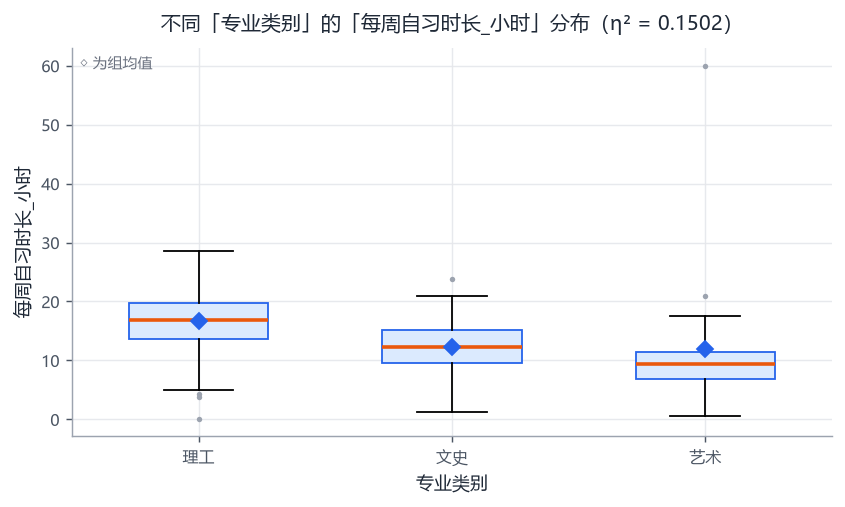
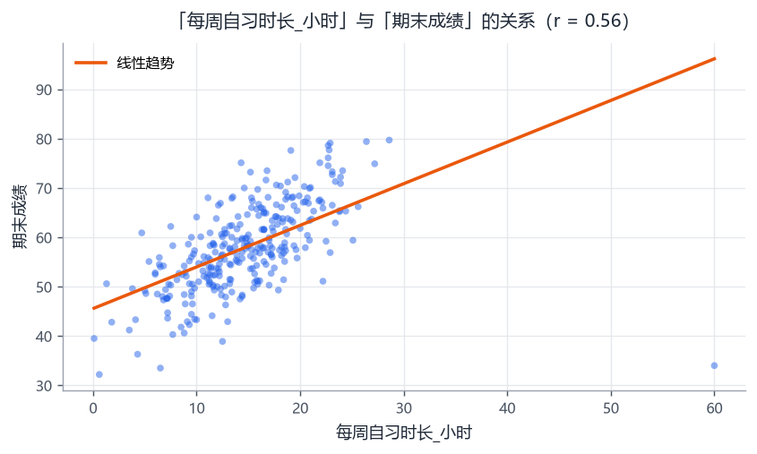

# 表格分析助手（Sheet Insight）

> 上传一份 Excel/CSV，自动找出其中值得说的发现，输出可以**直接放进报告**的文字和图表。

不是"聊天式数据分析"，而是"一键出报告"——**不需要你会提问**。

---

## 这个项目要解决什么问题

学生做课程实验、问卷调研、社团统计时，手里经常有一份表，但卡在同一个地方：

> "数据我有了，可我不知道该分析什么，也不知道报告里那段'结果分析'该写什么。"

现成的工具都没解决这个断层：
- **Excel** 能画图，但不会告诉你哪张图值得画
- **ChatGPT 高级数据分析** 要你自己会提问，而且结果是聊天记录，还得自己整理
- **BI 工具**（Tableau/PowerBI）学习成本高，要自己拖拽配置

这个产品做的事：**替你判断"数据里什么值得说"，然后直接把话说出来。**

---

## 技术核心：算与说分离

这是整个项目的设计支点，也是它区别于"AI 套壳"的地方。

大模型的算术不可靠——它会一本正经地编出"平均分提高了 23%"，而真实数字可能是 12%。所以架构上做严格分工：

```
上传表格
   ↓
【统计层】pandas / scipy 真实计算
   数据画像 · 相关性 · 组间差异 · 时间趋势 · 异常值
   输出：精确数字 + 待解释的发现
   ↓  数字白名单（LLM 只能引用，不许自己算）
【表达层】LLM
   ① 把数字说成人话  ② 生成绘图代码
   ↓
报告片段：结论文字 + 图表
```

一句话：**"我不信任大模型算数，所以只让它解释统计结果，所有数字都来自真实计算。"**

---

## 效果示例

输入一份 300 行的学生问卷（[`data/sample_survey.csv`](data/sample_survey.csv)，14 列），不提问、不配置，直接输出 6 条发现。

完整成品：[`results/report.md`](results/report.md)（含数据画像表、图文结论、数据质量提示、局限说明）

**发现一 · 组间差异**——自动选箱线图，并标出各组均值：



> 不同「专业类别」的「每周自习时长」存在显著差异：「理工」组最高（16.7），「艺术」组最低（11.9），效应量 η² = 0.1502。

**发现三 · 关联关系**——自动选散点图 + 回归线，标题直接带 r 值：



> 「每周自习时长」与「期末成绩」呈中等正相关（r = 0.56）。报告中只写"相关"，不写"导致"。

每条发现都附带 **关键数字 + 依据字段**，用户可以自己核对：

```
### 3. 【关联关系】「每周自习时长_小时」与「期末成绩」呈中等以上正相关（r=0.56）

**结论**：「每周自习时长_小时」与「期末成绩」之间存在正相关（r = 0.56，样本 300 条）……
        需要说明的是，这只是相关关系，不能说明其中一个直接决定了另一个。

**关键数字**：r = 0.56、p = 3.76e-26、n = 300、均值_a = 14.6、均值_b = 57.88
**依据**：基于 每周自习时长_小时, 期末成绩；统计量见上，可自行核对。
```

---

## 当前进度

| 模块 | 状态 | 说明 |
|---|---|---|
| 数据画像 | ✅ 完成 | 列类型识别、缺失率、分布统计 |
| 发现引擎 | ✅ 完成 | 相关 / 组间差异 / 趋势 / 异常值 / 数据质量，共 5 类 |
| 结果排序 | ✅ 完成 | 类型多样性 + 去重 + 分数归一化 |
| 自动化验收（M2） | ✅ 完成 | 7 个已知规律召回 7/7，边界情况 4/4 不崩 |
| AI 表达层 | ✅ 完成 | 模板 / 大模型双后端，每条文案强制过数字守卫 |
| 数字守卫 | ✅ 完成 | 明显错误召回 100%，合法改写误杀 0% |
| 图表生成 | ✅ 完成 | 4 种发现类型自动配图，中文字体自适应 |
| 报告导出 | ✅ 完成 | Markdown 报告，含画像表 / 图 / 关键数字 / 局限说明 |
| Web 界面 | ⬜ 待做 | 上传 → 结果页 → 导出 |
| 部署上线 | ⬜ 待做 | 可分享链接 |
| 用户验证 | ⬜ 待做 | 10~15 个真实用户 |

---

## 运行方法

```bash
# 1. 安装依赖
python -m pip install pandas numpy scipy openpyxl matplotlib

# 2. 生成模拟数据（内置 300 行问卷数据，里面埋了 7 个已知规律）
python simulate_data.py

# 3. 分析（只出统计结果，不出文字）
python analyze.py                    # 分析模拟数据
python analyze.py 你的表格.xlsx       # 分析任意表格

# 4. 生成报告（统计结果 → 中文结论 + 图表）
python narrate.py                    # 有 API Key 用大模型，没有就用模板
python narrate.py --backend template # 强制离线（不联网、不需要 Key）
#   产物：results/report.md + results/charts/*.png + results/narration.json

# 5. 跑验收测试（改完代码必跑）
python verify.py                     # 发现引擎（M2）
python verify_m3.py                  # 表达层与数字守卫（M3）
```

### 接大模型（可选）

任何 OpenAI 兼容接口都能用，设三个环境变量即可（Key 不必写进代码）：

```bash
# PowerShell
$env:SHEET_INSIGHT_API_KEY="sk-..."
$env:SHEET_INSIGHT_BASE_URL="https://api.deepseek.com/v1"   # 可换智谱/通义/本地 Ollama
$env:SHEET_INSIGHT_MODEL="deepseek-chat"
```

不设也能用——会自动退回模板后端，功能完整，只是文笔平一些。

---

## 目录结构

```
sheet-insight/
├── PRD.md              # 产品需求文档（做什么 / 不做什么 / 里程碑）
├── analyze.py          # 发现引擎（统计层核心，只算不说）
├── number_guard.py     # 数字守卫（校验模型有没有改数字）
├── narrate.py          # 表达层 + 报告排版（M3 主流程）
├── charts.py           # 自动配图（4 种发现类型）
├── simulate_data.py    # 模拟数据生成器（埋了 7 个已知规律用于验收）
├── verify.py           # M2 验收：发现引擎召回率 + 边界情况
├── verify_m3.py        # M3 验收：降级链 + 检测器评测 + 数字保真度
├── data/               # 数据文件
└── results/
    ├── discoveries.json   # 结构化统计结果（含数字白名单来源）
    ├── report.md          # 成品报告
    ├── narration.json     # 质检记录（用了哪个后端、拦了几次、降级原因）
    └── charts/*.png       # 报告配图
```

---

## 设计决策记录

记录几个"踩过坑才改对"的地方，这些比功能列表更能说明工程过程。

### 1. 列类型识别必须用 `is_string_dtype`，不能判断 `dtype == object`

pandas 3.x 读进来的字符串列 dtype 是 `str`，不再是 `object`。第一版用 `dtype == object` 判断，结果**所有分类列（性别、专业、参加社团）全被漏掉**，组间差异和时间趋势两类分析直接空白——而且程序不报错，只是"什么也没找到"。

> 教训：**沉默的错误比崩溃更危险。** 崩溃你至少知道要修，静默失败会让你以为"这份数据没什么规律"。

### 2. 异常值检测用稳健 z 分数，不用 1.5 倍 IQR

1.5 IQR 在偏态分布上会把大量正常值判成异常（第一版把"睡眠 4.1 小时"也标成了异常）。改用基于中位数和 MAD 的稳健 z 分数后，"下周自习 60 小时"这种真正的录入错误（偏离 9.3 倍）被准确拎出来，而正常的极端值不会误报。

### 3. 排序规则：不要给"重复出现的列"打折

中间版本给已出现过的列打 7.5 折，本意是避免重复。结果适得其反：**「每周自习时长」同时出现在组间差异和趋势里，被打了两次折，导致它和成绩的相关性（r=0.56，全表最重要的一条）被挤出榜单。**

> 教训：**压制重复的副作用，会误伤核心变量。** 改成"同一分类列只出一条差异 + 同类最多 3 条"，其余老实按分数排。

### 4. 时间趋势不能按周聚合

原设计按周聚合再判断趋势，但测试数据只跨 30 天，聚完只剩 4~5 个点，趋势判断全部失效（0 条结果）。改成对原始记录做线性回归（300 个点全用上），并要求"全期变化量 > 数据标准差的 30%"才算真趋势。

### 5. 必须有验收脚本

因为上面第 3 条，我在调排序规则时**两次把已经能找到的规律弄丢**，而且当时没察觉。所以写了 `verify.py`：7 个已知规律的召回率 + 4 个边界情况不崩。**改完代码必跑**。

### 6. 数字守卫的容差必须用"相对偏差 5%"，不能用"按小数位给绝对容差"

这是 M3 最值钱的一个坑。第一版守卫的规则是：文本里的数和白名单里的数相差不超过半个最低位（写一位小数就允许 ±0.05），就算"同一个数"。

结果验收脚本的漏判率高达 27%：

- `η² = 0.1502` 被说成 **0.2** → 差 33%，但绝对值只差 0.0498，正好落在 ±0.05 里，放行
- `r = 0.619` 被说成 **1** → 相当于把"中等相关"说成"完全相关"，也放行了

改成"相对偏差不超过 5%"之后，同一个数不管写成几位小数，判断标准都一致：`0.62 / 0.6` 放行（偏 0.16% / 3%），`0.2` 拦下（偏 33%）。

> 教训：**容差的单位选错，规则就会在自己看不见的地方失效。** 绝对容差对 0.15 这种小数值特别危险——它允许的误差比数值本身还大。

### 7. 必须有一个"不需要网络"的兜底后端

大模型会挂（超时、限流、余额不足），也会不听话。所以表达层做了两套：

```
LLM 正常        → 用 LLM 文案
LLM 编数字      → 带着违规清单重试一次
还是编 / 调用失败 → 用模板文案
```

四步走完，报告**一定能生成，且数字一定对**。模板写得像流水线，但它是产品的最后一道防线。

`verify_m3.py` 用三种假模型（诚实 / 说谎 / 挂掉）把这条链逐个跑了一遍，全部通过。

### 8. 图表用固定模板，而不是让大模型写代码

PRD 里原本设想"LLM 生成 matplotlib 代码 + 沙箱执行"。实际做下来改成了模板选图，原因很实在：

- 只有 4 种发现类型对应 4 种图，映射关系是确定的。让 LLM 每次重新发明一遍，只是多了一个出错环节；
- 固定模板能保证字体正常、坐标轴有标签、标题带统计量——这些"不起眼但决定能不能用"的细节，LLM 经常漏。

沙箱执行 LLM 代码是有价值的技术点，但它解决的是"未知图表需求"。等做到第二版的"用户自定义绘图"时再引入，那时它才真的必要。

### 9. 门槛设成"至少 50 行"，等于把整类真实表格拒之门外

前 8 条都是在模拟数据上踩的坑，这条是**换成真实表格才暴露出来的**，也最典型。

拿一份 31 个省的 GDP 与社会消费品零售总额数据（31 行 × 3 列，很标准的统计学上机数据）跑引擎，输出是：

```
[相关性] 候选 0 条
[组间差异] 候选 0 条
[时间趋势] 候选 0 条
最终入选 0 条 / 候选 1 条
```

一条都没有。可那张表里 **r = 0.973、p = 5.65e-20**，是全表唯一也是最重要的结论。

根因是引擎里写着一行 `MIN_PAIR_N = 50`——当初在 300 行的问卷数据上调出来的，从那以后就没人碰过。于是任何几十行的表格（真实场景里极常见）连相关性都进不去。

真正的错在于把两件事做成了一件：**p 值门槛本来就随样本量自动调整**（n 变小时，同样的 r 更难显著），再压一个 n ≥ 50 是重复限制。现在硬下限降到 12，只用来挡"3 个点连成一条直线"，把关交给 p 值和 |r|。

同一张真实表格还顺带暴露了三个小问题，一起修了：

- 标题对 r=0.97 和 r=0.51 都写"中等以上正相关"→ 抽出 `corr_strength()` 统一分级，正文与标题共用一套口径，不再自相矛盾；
- 一张没有数据质量问题的表，报告章节会从"二、主要发现"直接跳到"四、局限说明"→ 章节序号改成跟着实际章节走；
- 没有达到门槛的表只打印一行提示、连报告都不生成 → 改成照样出一份报告，写清楚"为什么没有发现"。

> 教训：**用一份数据调出来的阈值，迟早会在另一份数据上出事。** 而且是静默地出事——它不报错，只是安静地把真结论丢掉。这也是为什么第 5 条那个验收脚本不够用：它守的是"别把已有的规律弄丢"，守不住"换一种表格就整类失效"。

---

## 数字守卫的实测指标

`verify_m3.py` 把守卫当成一个二分类器来评，两个方向都要好：

| 指标 | 结果 | 为什么重要 |
|---|---|---|
| 明显错误（偏离 ≥15%）召回 | **100%**（30/30） | 漏一个，报告里就多一个假数字 |
| 合法改写误杀 | **0%**（0/30） | 见谁都拦等于没拦，系统会永远退回模板 |
| 轻微偏离（10%）召回 | 100%（6/6） | 辅助参考，理论上存在与舍入撞车的盲区 |
| 数字保真度 | **6/6** | 换独立算法从原表重算，逐条对账 |

> 最后一条才是"结论准确率 100%"的真正来源：不是"模型没改数字"，而是"数字和原始数据对得上"。

---

## 设计原则

1. **宁可少说，不许乱说。** 证据不足就不出结论；样本量太小直接告诉用户"数据不够"，而不是硬算一个数字出来。
2. **所有数字可追溯。** 每条结论都带原始统计量（r、p、n、各组均值），用户能自己核对。
3. **诚实标注局限。** 相关不等于因果，输出里不写"导致"，只写"相关"。
