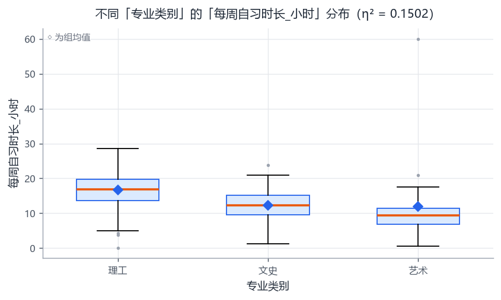
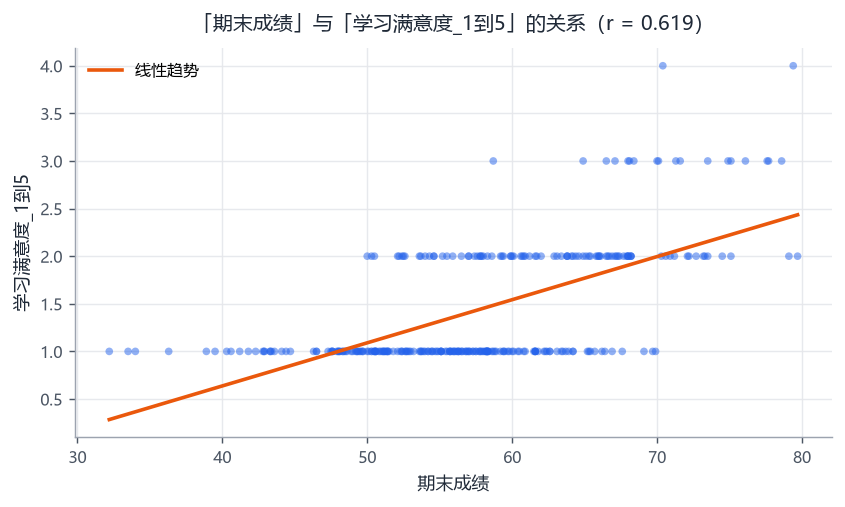
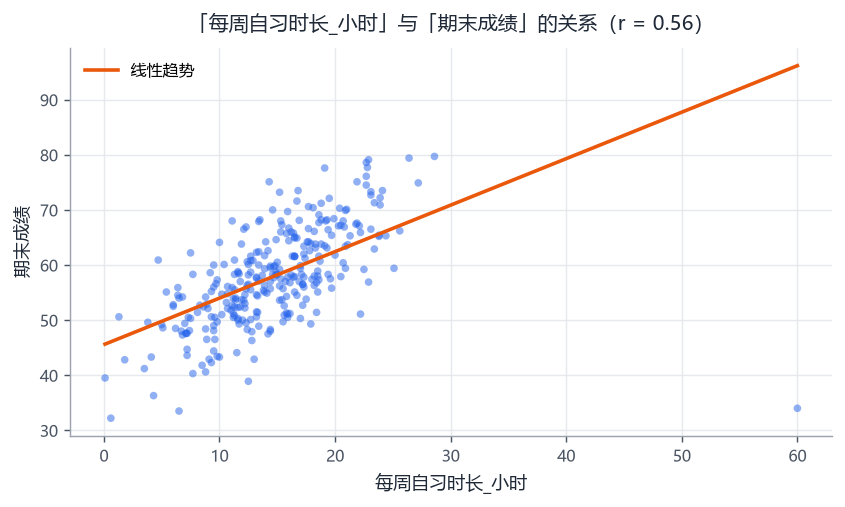
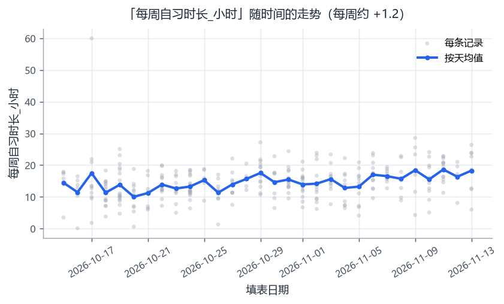
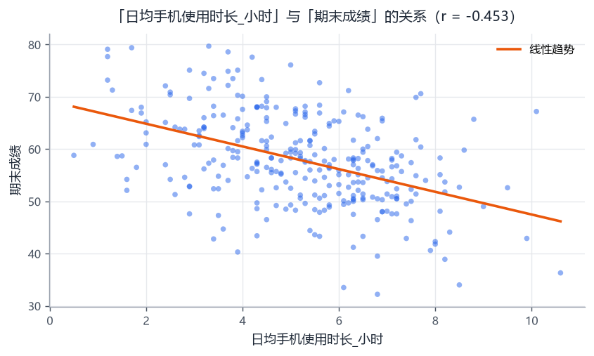
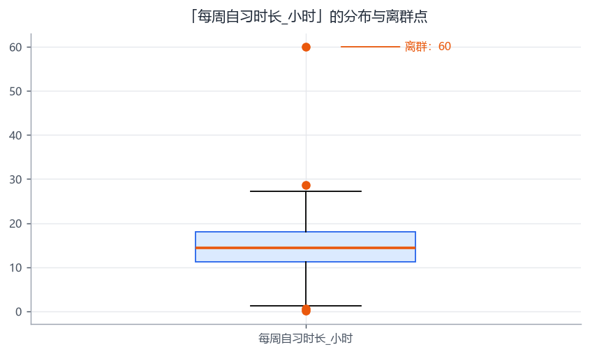

# 数据分析报告：sample_survey.csv

> 自动生成于 2026-11-15 14:19 · 共 6 条发现 · 全部由模板生成（未联网）

> 本报告中所有数值均由 pandas / scipy 直接计算，语言模型只负责表达，且经过数字校验。

---

## 一、数据概况

共 **300** 行 × **14** 列。

| 字段 | 类型 | 缺失率 | 唯一值 | 概要 |
|---|---|---|---|---|
| 学号 | 编号 | 0% | 300 | — |
| 填表日期 | 日期 | 0% | 30 | — |
| 性别 | 分类 | 0% | 2 | 最多为「女」（50%） |
| 年级 | 分类 | 0% | 4 | 最多为「大一」（28%） |
| 专业类别 | 分类 | 0% | 3 | 最多为「理工」（53%） |
| 每周自习时长_小时 | 数值 | 0% | 155 | 均值 14.6，范围 0.1 ~ 60.0 |
| 日均睡眠时长_小时 | 数值 | 0% | 47 | 均值 6.8，范围 4.1 ~ 9.2 |
| 每周早餐次数 | 数值 | 0% | 8 | 均值 3.4，范围 0.0 ~ 7.0 |
| 日均手机使用时长_小时 | 数值 | 0% | 79 | 均值 5.21，范围 0.5 ~ 10.6 |
| 参加社团 | 分类 | 0% | 2 | 最多为「是」（50%） |
| 期末成绩 | 数值 | 0% | 201 | 均值 57.88，范围 32.2 ~ 79.7 |
| 学习满意度_1到5 | 数值 | 0% | 4 | 均值 1.45，范围 1.0 ~ 4.0 |
| 备注 | 分类 | 68% | 4 | 最多为「希望多一些自习室」（30%） |
| 问卷版本 | — | 0% | 1 | — |

## 二、主要发现

### 1. 【组间差异】不同「专业类别」的「每周自习时长_小时」存在显著差异：理工最高（16.7），艺术最低（11.9）

**结论**：不同「专业类别」的「每周自习时长_小时」存在明显差异：「理工」组最高（平均 16.7），「艺术」组最低（11.9）。效应量 η² = 0.1502，意味着「专业类别」可以解释约 15% 的每周自习时长_小时差异，这个差异幅度在实际中是可以感受到的。

**关键数字**：eta2 = 0.1502、p = 3.18e-11、n = 300、最高组 = 理工、最低组 = 艺术；组均值：理工 16.7 / 文史 12.27 / 艺术 11.9

**依据**：基于 专业类别, 每周自习时长_小时；统计量见上，可自行核对。

### 2. 【关联关系】「期末成绩」与「学习满意度_1到5」呈中等以上正相关（r=0.62）

**结论**：「期末成绩」与「学习满意度_1到5」之间存在正相关（r = 0.619，样本 300 条）。相关系数 0.62 属于较强程度，也就是说期末成绩较高的样本，学习满意度_1到5倾向于也较高。需要说明的是，这只是相关关系，不能说明其中一个直接决定了另一个。

**关键数字**：r = 0.619、p = 4.48e-33、n = 300、均值_a = 57.88、均值_b = 1.45

**依据**：基于 期末成绩, 学习满意度_1到5；统计量见上，可自行核对。

### 3. 【关联关系】「每周自习时长_小时」与「期末成绩」呈中等以上正相关（r=0.56）

**结论**：「每周自习时长_小时」与「期末成绩」之间存在正相关（r = 0.56，样本 300 条）。相关系数 0.56 属于中等程度，也就是说每周自习时长_小时较高的样本，期末成绩倾向于也较高。需要说明的是，这只是相关关系，不能说明其中一个直接决定了另一个。

**关键数字**：r = 0.56、p = 3.76e-26、n = 300、均值_a = 14.6、均值_b = 57.88

**依据**：基于 每周自习时长_小时, 期末成绩；统计量见上，可自行核对。

### 4. 【时间趋势】「每周自习时长_小时」随时间呈上升趋势：每周约+1.19，全期累计+5.0

**结论**：「每周自习时长_小时」随时间呈上升趋势：平均每周增加 1.2，29 天里累计增加 4.95。这个变化幅度超过了数据本身的日常波动，因此更可能是真实趋势，而不是随机起伏。

**关键数字**：每周变化 = 1.195、全期变化 = 4.95、p = 1.11e-05、n = 300、跨度天数 = 29、起止 = 2026-10-15 ~ 2026-11-13

**依据**：基于 填表日期, 每周自习时长_小时；统计量见上，可自行核对。

### 5. 【关联关系】「日均手机使用时长_小时」与「期末成绩」呈中等以上负相关（r=-0.45）

**结论**：「日均手机使用时长_小时」与「期末成绩」之间存在负相关（r = -0.453，样本 300 条）。相关系数 0.45 属于中等程度，也就是说日均手机使用时长_小时较高的样本，期末成绩倾向于也较低。需要说明的是，这只是相关关系，不能说明其中一个直接决定了另一个。

**关键数字**：r = -0.453、p = 1.34e-16、n = 300、均值_a = 5.21、均值_b = 57.88

**依据**：基于 日均手机使用时长_小时, 期末成绩；统计量见上，可自行核对。

### 6. 【异常值】「每周自习时长_小时」有 1 个明显离群的值，最极端的是 60.0（中位数 14.40，偏离 9.3 倍稳健标准差）

**结论**：「每周自习时长_小时」中有 1 个明显偏离整体的值，最极端的是 60，而中位数只有 14.4，偏离了 9.32 倍稳健标准差。这类值通常是录入错误或极端个案，建议回到原始问卷核对这一条记录，确认后再决定是否保留。

**关键数字**：离群个数 = 1、最极端值 = 60.0、中位数 = 14.4、偏离倍数 = 9.32、样本数 = 300

**依据**：基于 每周自习时长_小时；统计量见上，可自行核对。

## 三、数据质量提示

| 字段 | 问题 | 严重度 |
|---|---|---|
| 备注 | 缺失率 68.0%，相关分析结论需谨慎 | 中 |
| 问卷版本 | 所有值都是「v1」，无分析价值 | 低 |

## 四、局限说明

- 本报告只做**描述性分析**，说明数据中呈现的关系，**不能证明因果关系**。
- 结论的可靠性依赖样本质量；缺失率高或类别极不均衡的字段已在上表中标出。
- 样本量 300 行，在小样本下，个别极端值可能对统计量产生较大影响。

---

*由「表格分析助手」生成：统计层负责计算，表达层负责措辞，两件事严格分开。*